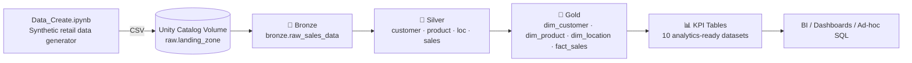
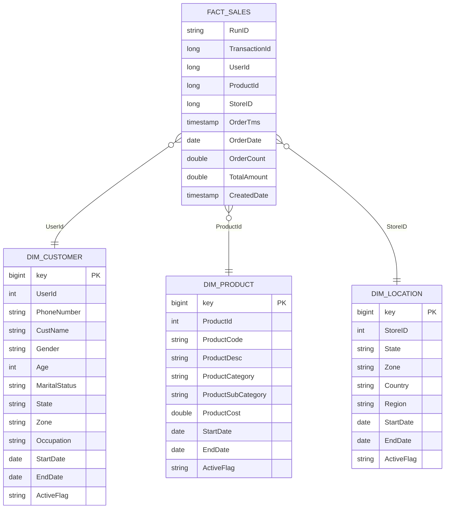

# 🛒 RetailFlow: End-to-End Data Engineering & Analytics Pipeline


**RetailFlow** is an end-to-end data engineering and analytics pipeline built on **Databricks**, **PySpark**, **SQL** and **Delta Lake**. It follows the **Medallion Architecture (Bronze → Silver → Gold)** to turn raw retail transaction data into a clean **star schema** and a set of **analytics-ready KPI tables** for reporting, customer segmentation and business insights.

The whole pipeline is orchestrated with **Databricks Workflows** and packaged as a **Databricks Asset Bundle (DAB)**, so it can be validated, deployed and run across `dev` and `prod` environments with a few CLI commands.

---

## 📑 Table of Contents

- [Highlights](#-highlights)
- [Architecture](#-architecture)
- [Tech Stack](#-tech-stack)
- [Repository Structure](#-repository-structure)
- [Data Source & Synthetic Data Generation](#-data-source--synthetic-data-generation)
- [Pipeline Layers in Detail](#-pipeline-layers-in-detail)
  - [Bronze](#-bronze-layer--raw-ingestion)
  - [Silver](#-silver-layer--cleansing--standardization)
  - [Gold](#-gold-layer--dimensional-model--kpis)
- [Data Model](#-data-model-star-schema)
- [SCD Type 2 Logic](#-scd-type-2-logic)
- [KPI Tables](#-kpi-tables)
- [Customer Segmentation (RFM)](#-customer-segmentation-rfm)
- [Orchestration & Deployment](#-orchestration--deployment)
- [Getting Started](#-getting-started)
- [Example Queries](#-example-queries)
- [Design Decisions](#-design-decisions)
- [Future Enhancements](#-future-enhancements)
- [Known Limitations](#️-known-limitations)
- [Author](#-author)

---

## ✨ Highlights

- **Medallion Architecture** on Delta Lake with separate `raw`, `bronze`, `silver` and `gold` schemas inside a Unity Catalog catalog.
- **Reproducible data generation**: a seeded PySpark notebook produces a realistic multi-dimensional retail dataset (customers × stores × products) and lands it in a Unity Catalog **Volume**.
- **Standardized ingestion**: automatic column-name normalization to Delta-compliant `PascalCase`.
- **Data cleansing in SQL**: null handling with `COALESCE`, trimming, type casting and de-duplication with `QUALIFY ROW_NUMBER()`.
- **Star schema** with three **SCD Type 2** dimensions (`dim_customer`, `dim_product`, `dim_location`) built using Delta `MERGE`.
- **Idempotent, incremental fact loading** keyed on a `RunID`, so a run can be safely re-executed without duplicating data.
- **10 business-ready KPI tables** covering store, product, customer, daily trends, RFM segmentation, product ranking and an executive summary.
- **Infrastructure as code** with Databricks Asset Bundles, two workflows, task dependencies, retries, timeouts and email notifications.

---

## 🏗 Architecture



| Layer | Schema | Purpose |
|-------|--------|---------|
| **Landing / Raw** | `raw` | Volume (`landing_zone`) that holds the incoming CSV files |
| **Bronze** | `bronze` | Raw data persisted as a Delta table with standardized column names, no business logic |
| **Silver** | `silver` | Cleansed, typed and de-duplicated entity tables (customer, product, location, sales) |
| **Gold** | `gold` | Star schema (facts + SCD2 dimensions) and aggregated KPI tables |

---

## 🧰 Tech Stack

| Category | Technology |
|----------|-----------|
| Platform | Databricks (Unity Catalog, Workflows, Volumes) |
| Processing | Apache Spark / PySpark |
| Storage format | Delta Lake |
| Languages | Python, SQL |
| Modeling | Medallion Architecture, Star Schema, SCD Type 2 |
| Orchestration & IaC | Databricks Workflows, Databricks Asset Bundles (YAML) |
| Notebooks | Databricks `.ipynb` notebooks |

---

## 📁 Repository Structure

```
RetailFlow/
├── README.md
├── databricks.yml                      # Asset Bundle config (dev & prod targets)
├── resources/
│   ├── data_create_workflow.yml        # Job 1: generate & land raw data
│   └── data_modeling_workflow.yml      # Job 2: Bronze → Silver → Gold
└── src/
    ├── Data_Create.ipynb               # Synthetic data generation → landing zone
    ├── Bronze.ipynb                    # Raw ingestion into Delta
    ├── Silver.ipynb                    # Cleansing & standardization
    └── Gold.ipynb                      # Dimensions, fact table & KPIs
```

---

## 🧪 Data Source & Synthetic Data Generation

`Data_Create.ipynb` generates a **reproducible** retail dataset (`random.seed(42)`) so the pipeline can be run end-to-end without any external data source.

**Base entities**

| Entity | Count | Description |
|--------|-------|-------------|
| Customers | 14 | Demographics: gender, age, age group, marital status, state, zone, occupation, phone number |
| Stores | 5 | One per region: Central, Northern, Southern, Western, Eastern |
| Products | 5 | Auto-category products (e.g. *Auto Care Premium*, *Engine Guard Pro*, *Brake Fluid Advanced*) with a unit cost |

**Transaction generation**

Every customer is combined with every store and every product (**14 × 5 × 5 = 350 transactions** per run). For each record the generator creates:

- a random 8-digit `Transaction_ID`,
- a random order quantity (1–4) and `Amount = Orders × ProductCost`,
- an order timestamp offset by 0–30 days from the run time,
- a `RunID` (run date, `YYYYMMDD`) and `CreatedDate` for lineage and incremental loading.

**Output**: a single CSV (with header) written to the Unity Catalog Volume:

```
/Volumes/data_modeling/raw/landing_zone/sales_<YYYYMMDD>.csv
```

**Raw schema (25 columns)**

`Transaction_ID, User_ID, phone_number, Cust_name, Product_Code, ProductCost, Gender, Age_Group, Age, Marital_Status, State, Zone, Occupation, Product_Category, Product_SubCategory, Orders, Amount, Product_ID, Product_Desc, OrderTms, Country, StoreID, Region, RunID, CreatedDate`

---

## 🔬 Pipeline Layers in Detail

### 🥉 Bronze Layer – Raw Ingestion

**Notebook:** `src/Bronze.ipynb`

1. Reads the day's CSV from the landing-zone Volume with `header=true` and `inferSchema=true`.
2. Normalizes column names with a reusable `format_columns_for_delta()` helper. It strips illegal Delta characters (spaces, `,;{}()=`, newlines and tabs) and supports `snake_case`, `camelCase`, `PascalCase` and `lowercase` conventions. The pipeline uses **PascalCase** (e.g. `Transaction_ID → TransactionId`, `phone_number → PhoneNumber`).
3. Writes the result to **`bronze.raw_sales_data`** as a Delta table (`overwrite` + `overwriteSchema`).

> Bronze keeps the data as close to the source as possible. No filtering or business rules are applied.

### 🥈 Silver Layer – Cleansing & Standardization

**Notebook:** `src/Silver.ipynb`

The denormalized Bronze table is split into four clean, typed entity tables using SQL:

| Table | Grain | Key transformations |
|-------|-------|--------------------|
| `silver.customer` | One row per `UserId` | `COALESCE` for nulls, `TRIM` on strings, explicit casts, de-duplication via `QUALIFY ROW_NUMBER() OVER (PARTITION BY UserId …) = 1` |
| `silver.product` | One row per product | Null-safe, trimmed attributes; `AVG(ProductCost)` aggregated per product |
| `silver.loc` | One row per `StoreID` | De-duplicated to the latest record (`ORDER BY OrderTms DESC`) |
| `silver.sales` | One row per transaction | Casts to `long` / `double` / `timestamp`, derives `OrderDate`, renames `Orders → OrderCount` and `Amount → TotalAmount` |

### 🥇 Gold Layer – Dimensional Model & KPIs

**Notebook:** `src/Gold.ipynb`

1. **Dimensions** (`dim_customer`, `dim_product`, `dim_location`) are maintained as **SCD Type 2** using a two-step `MERGE` pattern.
2. **Fact table** `gold.fact_sales` is loaded incrementally by `RunID`: existing rows for the run are deleted, then the new rows are appended, which makes reruns idempotent.
3. **KPI tables** are computed from `silver.sales` with PySpark aggregations and appended per `RunID` (delete-then-append for idempotency).

---

## 🧩 Data Model (Star Schema)



Dimension tables use a Delta **identity column** (`GENERATED ALWAYS AS IDENTITY`) as the surrogate `key`.

---

## 🕰 SCD Type 2 Logic

Each dimension tracks history with `StartDate`, `EndDate` and `ActiveFlag` (`'Y'` = current version, `'N'` = historical). The current record's `EndDate` is `9999-12-31`.

For every dimension the notebook does the following:

1. **Build a staging view** that unions:
   - all incoming Silver rows, using the business key as `mergkey`, and
   - a second copy of only the **changed** rows (joined to the active dimension record and compared attribute by attribute), using a non-matching `mergkey`.
2. **`MERGE INTO`** the dimension:
   - `WHEN MATCHED` and an attribute changed → **expire** the old row (`EndDate = current_date()`, `ActiveFlag = 'N'`).
   - `WHEN NOT MATCHED` → **insert** a new active row (brand-new keys *and* the new version of changed keys).

This single-statement pattern both closes the old version and inserts the new one, preserving the full change history.

---

## 📊 KPI Tables

All KPI tables are written to the `gold` schema and tagged with `RunID` and `CreatedDate`.

| # | Table | Grain | What it answers |
|---|-------|-------|----------------|
| 1 | `gold.kpi_store` | Store | Transactions, orders, revenue, avg / max / min transaction value, revenue std. deviation |
| 2 | `gold.kpi_product` | Product | Transactions, orders, revenue, avg transaction value, unique customers, store distribution |
| 3 | `gold.kpi_customer` | Customer | Transactions, orders, total spend, products bought, stores visited, first / last purchase date |
| 4 | `gold.kpi_store_product` | Store × Product | Which products perform best in which stores |
| 5 | `gold.kpi_customer_product` | Customer × Product | Purchase frequency, orders and spend per customer per product |
| 6 | `gold.kpi_daily` | Order date | Daily revenue trend, unique customers, active stores |
| 7 | `gold.kpi_rfm` | Customer | Recency, Frequency, Monetary and customer segment |
| 8 | `gold.kpi_product_ranking` | Product | Revenue rank, volume rank, customer reach, units per customer |
| 9 | `gold.kpi_store_performance` | Store | Revenue per customer, transaction frequency, performance rank |
| 10 | `gold.kpi_summary` | Run | Executive metrics: total revenue, transactions, orders, unique customers / products / stores, averages |

---

## 🎯 Customer Segmentation (RFM)

`gold.kpi_rfm` computes **Recency** (days since last purchase relative to the latest order date), **Frequency** (transaction count) and **Monetary** (total spend) for each customer, and assigns a segment using rule-based logic:

| Segment | Rule |
|---------|------|
| **High Value** | Recency ≤ 15 days **and** Frequency ≥ 3 **and** Monetary ≥ 20,000 |
| **Active** | Recency ≤ 30 days **and** Frequency ≥ 2 |
| **At Risk** | Recency > 30 days |
| **Normal** | Everything else |

---

## ⚙️ Orchestration & Deployment

The project is deployed as a **Databricks Asset Bundle** (`databricks.yml`, bundle name `data_modeling`) with two targets:

| Target | Mode | Notes |
|--------|------|-------|
| `dev` (default) | `development` | Resources are prefixed per-user, ideal for iteration |
| `prod` | `production` | Deploys to a fixed workspace path and runs as a designated user / service principal |

### Workflow 1 – `Data Creation Workflow`
Defined in `resources/data_create_workflow.yml`

```
create  →  Data_Create.ipynb   (generate raw data & land it in the Volume)
```

### Workflow 2 – `Data Modeling Workflow`
Defined in `resources/data_modeling_workflow.yml`

```
data_ingestion  →  data_transformation  →  dim_fact_analysis
  (Bronze)            (Silver)                 (Gold)
```

Both workflows include:

- task **dependencies** (`depends_on`),
- **retries** (`max_retries: 1`) and per-task / job **timeouts**,
- `max_concurrent_runs: 1` to avoid overlapping runs,
- **email notifications** on success and failure,
- an `environment` base parameter passed to every notebook.

---

## 🚀 Getting Started

### Prerequisites

- A Databricks workspace with **Unity Catalog** enabled
- [Databricks CLI](https://docs.databricks.com/dev-tools/cli/install.html) (v0.205+) authenticated against your workspace
- Permission to create catalogs, schemas and volumes

### 1. Clone the repository

```bash
git clone https://github.com/Vanshikaaa28/RetailFlow.git
cd RetailFlow
```

### 2. Configure the bundle

Open `databricks.yml` and update the following for your own workspace:

- `workspace.host` for both `dev` and `prod`
- `root_path` and `run_as.user_name` in the `prod` target
- `email_notifications` addresses in `resources/*.yml`

### 3. Set up the catalog, schemas and volume (one-time)

The setup SQL is included (commented out) at the top of `Data_Create.ipynb` and `Bronze.ipynb`. Run it once in a Databricks SQL / notebook cell:

```sql
CREATE CATALOG IF NOT EXISTS data_modeling;
USE CATALOG data_modeling;

CREATE SCHEMA IF NOT EXISTS raw;
CREATE SCHEMA IF NOT EXISTS bronze;
CREATE SCHEMA IF NOT EXISTS silver;
CREATE SCHEMA IF NOT EXISTS gold;

CREATE VOLUME IF NOT EXISTS data_modeling.raw.landing_zone;
```

The Gold notebook also expects the three dimension tables to exist before the first `MERGE`. Uncomment and run the `CREATE OR REPLACE TABLE gold.dim_*` statements at the top of each dimension cell once to initialize them.

### 4. Validate and deploy

```bash
databricks bundle validate
databricks bundle deploy -t dev
```

### 5. Run the pipeline

```bash
# Step 1: generate and land the raw CSV
databricks bundle run data_create_workflow -t dev

# Step 2: Bronze → Silver → Gold
databricks bundle run data_modeling_workflow -t dev
```

For production, replace `-t dev` with `-t prod`.

### 6. Explore the results

```sql
USE CATALOG data_modeling;
SHOW TABLES IN gold;
SELECT * FROM gold.kpi_summary;
```

---

## 🔎 Example Queries

**Top-performing stores by revenue**

```sql
SELECT StoreID, TotalRevenue, RevenuePerCustomer, PerformanceRank
FROM gold.kpi_store_performance
ORDER BY PerformanceRank;
```

**Customer segment distribution**

```sql
SELECT CustomerSegment, COUNT(*) AS customers, ROUND(SUM(Monetary), 2) AS revenue
FROM gold.kpi_rfm
GROUP BY CustomerSegment
ORDER BY revenue DESC;
```

**Revenue by region and product category (star-schema join)**

```sql
SELECT l.Region, p.ProductCategory, SUM(f.TotalAmount) AS revenue
FROM gold.fact_sales f
JOIN gold.dim_location l ON f.StoreID  = l.StoreID  AND l.ActiveFlag = 'Y'
JOIN gold.dim_product  p ON f.ProductId = p.ProductId AND p.ActiveFlag = 'Y'
GROUP BY l.Region, p.ProductCategory
ORDER BY revenue DESC;
```

**Daily revenue trend**

```sql
SELECT OrderDate, DailyRevenue, UniqueCustomers
FROM gold.kpi_daily
ORDER BY OrderDate;
```

---

## 🧠 Design Decisions

- **Medallion layering** separates concerns: Bronze preserves the source, Silver enforces quality and types, Gold serves the business.
- **SQL for Silver, PySpark for KPIs**: set-based cleansing reads naturally in SQL, while the aggregations and window functions are easy to compose in the DataFrame API.
- **RunID-based idempotency**: every fact and KPI load deletes its own `RunID` before appending, so retries and reruns never create duplicates.
- **SCD Type 2 dimensions** keep full attribute history, so analytics can be traced to the attributes that were valid at the time.
- **Delta Lake** provides ACID transactions, schema enforcement / evolution (`overwriteSchema`, `mergeSchema`) and `MERGE` support.
- **Asset Bundles** make the pipeline portable and repeatable across environments.

---

## 🔮 Future Enhancements

- Incremental ingestion with **Auto Loader** instead of full-file reads
- Declarative data-quality checks (e.g. Delta Live Tables expectations or Great Expectations)
- Fact-to-dimension surrogate-key lookups at load time
- Dashboards on top of the Gold layer (Databricks SQL, Power BI or Tableau)
- CI/CD with GitHub Actions to validate and deploy the bundle on every push
- Parameterized catalog / schema names driven by the `environment` job parameter
- Additional KPIs such as customer lifetime value, cohort retention and basket analysis

---

## ⚠️ Known Limitations

- **Synthetic, small-scale data**: the dataset is generated (14 customers, 5 stores, 5 products) to demonstrate the pipeline design, not to benchmark performance at scale.
- **Full-refresh Bronze**: `bronze.raw_sales_data` is overwritten on each run, and the pipeline processes one day's file (`sales_<YYYYMMDD>.csv`) at a time.
- **Manual one-time setup**: the catalog, schemas, volume and initial `gold.dim_*` table DDL are provided as commented-out cells and must be run once before the first execution.
- **`RunID` filter in the fact load**: the delete step in `Gold.ipynb` compares `RunId` without quoting the string value; it should be `RunId = '{runid}'` for reruns to behave reliably.
- **Product sub-category**: the generator assigns the same value to `Product_Category` and `Product_SubCategory`.
- **`MaritalStatus` handling**: Silver applies `trim(COALESCE(MaritalStatus, 0))`, mixing a string function with an integer default; it should default to `'0'` or be cast explicitly.
- **No fact-to-dimension surrogate keys**: `fact_sales` joins to dimensions on business keys (filtered on `ActiveFlag`) rather than storing dimension surrogate keys.
- **No automated data-quality tests or CI/CD** yet (see Future Enhancements).

---

## 👩‍💻 Author

**Vanshika**
*Data Engineering • Analytics • AI*

I built RetailFlow to demonstrate a practical, production-style lakehouse pipeline from raw data to business insights. Feedback, questions and ideas are always welcome.

[](https://github.com/Vanshikaaa28/)
[](https://www.linkedin.com/in/vanshikaaa/)

- GitHub: [github.com/Vanshikaaa28](https://github.com/Vanshikaaa28/)
- LinkedIn: [linkedin.com/in/vanshikaaa](https://www.linkedin.com/in/vanshikaaa/)

⭐ If you found this project useful, consider giving it a star!
